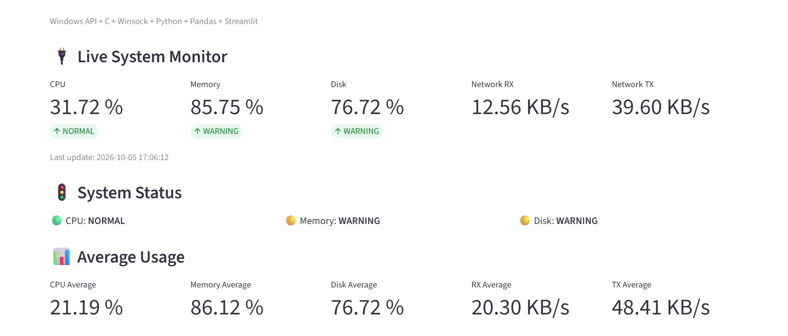
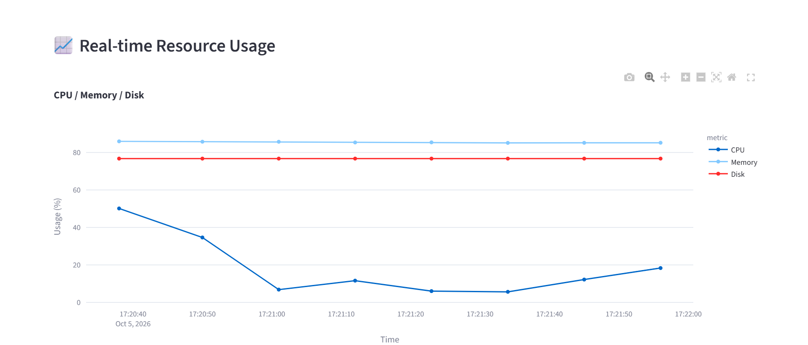
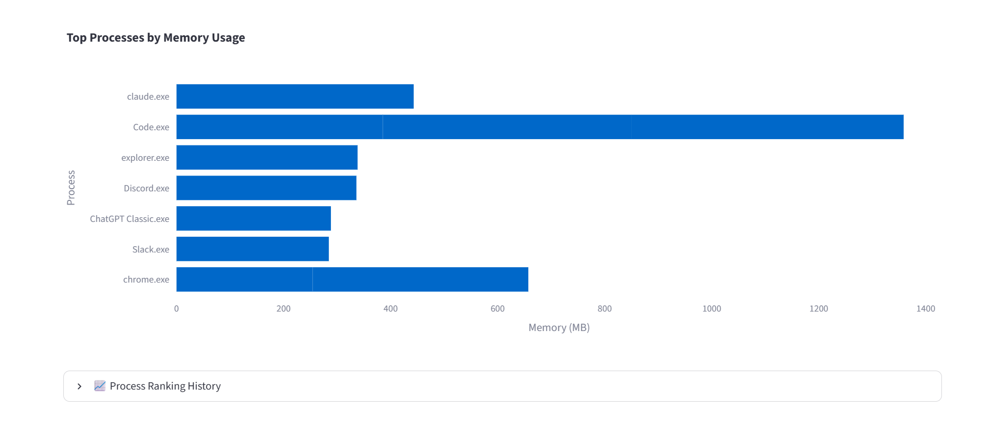

# C System Monitor Ver.4

Windows環境のシステムリソースをC言語でリアルタイム取得し、TCP通信を介してPythonへ送信、Streamlitで可視化するシステム監視ダッシュボードです。

C言語によるWindows APIを利用したシステム情報取得から、TCPソケット通信、Pythonによるデータ処理、Streamlitによる可視化までを一貫して実装しています。

本プロジェクトはAIとのペアプログラミングを通じて開発し、実装後にコードレビューを行っています(詳細は[Known Limitations](#-known-limitations)参照)。

---

## 📌 Overview

本システムでは、Windows PC上で動作するC言語の監視コアが以下の情報を定期的に取得します。

- CPU使用率
- メモリ使用率
- ディスク使用率
- ネットワーク受信速度
- ネットワーク送信速度
- プロセス情報
- プロセスごとのメモリ使用量

取得したシステム情報はTCP通信を利用してPythonへ送信され、Python側で受信・蓄積したデータをStreamlit Dashboardでリアルタイムに可視化します。

---

## 🖼️ Screenshots





---

## 🏗️ Architecture

```text
┌──────────────────────────────────────────────┐
│                 Windows PC                   │
│                                              │
│  ┌────────────────────────────────────────┐  │
│  │  C System Core                         │  │
│  │                                        │  │
│  │  Windows API                           │  │
│  │   ├─ CPU                               │  │
│  │   ├─ Memory                            │  │
│  │   ├─ Disk                              │  │
│  │   ├─ Network                           │  │
│  │   └─ Process                           │  │
│  │                                        │  │
│  │  CSV Logging (logs/*.csv)              │  │
│  │  Process Ranking (Top 10)              │  │
│  │  TCP Server (127.0.0.1:5000)           │  │
│  └────────────────┬───────────────────────┘  │
│                   │                          │
│                   │ TCP / NDJSON             │
│                   ↓                          │
│  ┌────────────────────────────────────────┐  │
│  │  Python Live Monitor                   │  │
│  │                                        │  │
│  │  Socket Receive                        │  │
│  │  JSON Decode                           │  │
│  │  Data Validation                       │  │
│  │  Thread / Lock                         │  │
│  │  In-memory History (max 300)           │  │
│  └────────────────┬───────────────────────┘  │
│                   │                          │
│                   ↓                          │
│  ┌────────────────────────────────────────┐  │
│  │  Streamlit Dashboard                   │  │
│  │                                        │  │
│  │  CPU / Memory / Disk     (from TCP)    │  │
│  │  Network RX / TX         (from TCP)    │  │
│  │  Process Ranking         (from CSV)    │  │
│  │  Historical Logs         (from CSV)    │  │
│  │  Alert History           (from CSV)    │  │
│  │  Plotly Visualization                  │  │
│  └────────────────────────────────────────┘  │
│                                              │
└──────────────────────────────────────────────┘
```

※ Process Ranking / Historical Logs / Alert History は、TCPではなくC側が書き出したCSV(`logs/`)をStreamlitが直接読み込みます。

---

## ✨ Features

### 1. Real-time System Monitoring

C言語でWindows APIを利用してシステムリソースを取得します。

- **CPU**: `GetSystemTimes()` を利用してCPU使用率を計算します
- **Memory**: `GlobalMemoryStatusEx()` を利用してメモリ使用率を取得します
- **Disk**: `GetDiskFreeSpaceExA()` を利用してCドライブのディスク使用状況を取得します
- **Network**: `GetIfTable()` を利用して、稼働中のネットワークインターフェースの送受信バイト数の合計を取得し、前回の取得時点との差分からRX/TXを算出し、経過時間で割ってKB/sにします(JSON・CSVのキー名は`network_rx_kbps` / `network_tx_kbps`ですが、単位はKB/sです)

### 2. Process Monitoring

Windows上で動作しているプロセスを列挙し、プロセスごとのメモリ使用量を取得します。

取得には以下のWindows APIを利用しています。

- `CreateToolhelp32Snapshot()`
- `Process32First()`
- `Process32Next()`
- `OpenProcess()`
- `GetProcessMemoryInfo()`

メモリ使用量の多いプロセスをTOP 10ランキング形式で取得します。これにより、システムリソースを大量に消費しているプロセスを確認できます。

メモリ使用量にはワーキングセットサイズ(`WorkingSetSize`)を使用します。対象は最大1024プロセスで、アクセス権限がなく情報を取得できないプロセスはスキップされます(スキップ数はコンソールに表示)。ランキングは計測5回に1回更新され、`logs/process_ranking.csv`に追記されます。

### 3. TCP Socket Communication

C側がTCPサーバー、Python側がクライアントとして、TCPソケット(`127.0.0.1:5000`)で通信します。TCPで送信するのはCPU・メモリ・ディスク・ネットワークの計測値で、送信データにはNDJSON形式を採用しています。プロセスランキングはTCPでは送信せず、CSV経由でDashboardに渡します。

```json
{"timestamp":"2026-09-01 12:00:00","cpu":21.4,"memory":58.2,"disk":71.3,"network_rx_kbps":120.5,"network_tx_kbps":32.8}
```

NDJSONを採用することで、ストリームとして継続的にデータを送信できます。

### 4. Robust TCP Transmission

TCPでは1回の`send()`ですべてのデータが送信されるとは限らないため、C側では`send_all()`を実装しています。

```c
int send_all(SOCKET socket, const char *data, int length);
```

これにより、送信途中でデータが分割された場合にも対応しています。

### 5. Automatic Reconnection

Python Dashboardとの接続が切断された場合、C側は次回の送信失敗時に切断を検知し、接続を閉じて再び接続待機状態(`accept()`)に戻ります。Python側でも接続エラー発生時に再接続を試行します。なお、C側の計測・CSV記録はDashboardが接続している間のみ行われます([Known Limitations](#-known-limitations)参照)。

```text
Dashboard → Disconnect → C Server → Waiting for reconnect → Dashboard restart → Reconnect
```

### 6. Thread-safe Data Management

Python側ではバックグラウンドスレッドを利用してTCP通信を行っています。共有データへのアクセスには`threading.Lock()`を使用しています。

```python
with self.lock:
    self.data.append(record)
```

これにより、通信スレッドとDashboard側から同時にデータへアクセスする場合の競合を防止しています。

### 7. Real-time Dashboard

Streamlitを利用して監視データをリアルタイム表示します。Dashboardでは以下を確認できます。

- CPU / Memory / Disk / Network RX / Network TX
- 現在値・平均値(直近最大300件)・ステータス(WARNING: 70%以上 / CRITICAL: 90%以上)
- 時系列グラフ・ネットワークグラフ
- プロセスランキング
- 過去ログ・アラート履歴(アラート履歴は`logs/alert_log.csv`を読み込んで表示しますが、このファイルを生成する処理は未実装のため、現状はアラートが記録されません)

ライブ表示は10秒ごとに自動更新されます。

---

## 📊 Visualization

Plotlyを利用してシステムリソース(CPU / Memory / Disk)を時系列グラフとして表示します。ネットワークについても、Network RX / TXを別グラフとして表示します。

---

## 🗂️ Project Structure

```text
C System Monitor Ver.4
│
├─ build/
│   └─ monitor.exe
│
├─ docs/
│   ├─ screenshot-overview.png
│   ├─ screenshot-graphs.png
│   └─ screenshot-process-chart.png
│
├─ logs/
│   ├─ system_monitor.csv      (C側が追記)
│   ├─ process_ranking.csv     (C側が追記)
│   └─ alert_log.csv           (読み込みのみ・生成処理は未実装)
│
├─ python/
│   ├─ dashboard.py
│   └─ live_monitor.py
│
├─ src/
│   └─ main.c
│
└─ README.md
```

---

## 🛠️ Technologies

### C / Windows

| Technology | Purpose |
|---|---|
| C | System monitoring core |
| Win32 API | Windows system information |
| Winsock2 | TCP communication |
| PSAPI | Process memory information |
| Toolhelp32 | Process enumeration |
| IP Helper API | Network statistics |
| GCC / MinGW | Compilation |

### Python

| Technology | Purpose |
|---|---|
| Python | Data processing / monitoring |
| Socket | TCP communication |
| JSON | Data serialization |
| Pandas | Data processing |
| Streamlit | Dashboard |
| Plotly | Visualization |

---

## 📁 Log Data

システム監視データはCSVとして保存されます(C側が追記。`logs/`フォルダは事前に作成が必要です)。

**`logs/system_monitor.csv`**

```text
timestamp,cpu_usage,memory_usage,disk_usage,network_rx_kbps,network_tx_kbps
```

**`logs/process_ranking.csv`**

```text
timestamp,rank,pid,process_name,memory_mb
```

**`logs/alert_log.csv`**

Dashboardが読み込む想定のログですが、現時点ではこのファイルを生成する処理は未実装です(Future Improvementsの「アラート自動生成」で対応予定)。

---

## 🚀 Setup

### Requirements

- Windows 10 / 11
- Python 3.x
- GCC / MinGW
- Streamlit

### 1. Clone

```bash
git clone <repository-url>
cd "C System Monitor Ver.4"
```

### 2. Install Python packages

```bash
pip install streamlit pandas plotly
```

## 🔨 Build C Program

プロジェクトルートで、出力先とログ用のフォルダを作成します(初回のみ)。

```powershell
New-Item -ItemType Directory -Force build, logs
```

続けて、以下を実行します。

```bash
gcc src/main.c -o build/monitor.exe -lpsapi -lws2_32 -liphlpapi
```

## ▶️ Run

**Terminal 1 — C System Core**

```bash
.\build\monitor.exe
```

C側がTCP Server(`127.0.0.1:5000`)として起動します。

**Terminal 2 — Streamlit Dashboard**

```bash
streamlit run python\dashboard.py
```

ブラウザからDashboardへアクセスします。

どちらもプロジェクトルートで実行してください(`logs/`を相対パスで参照するため)。

> C側はDashboardが接続している間だけ計測を行うため、`monitor.exe`を起動しただけではCSVは記録されません。

---

## 🔄 Data Flow

システム起動後は以下の流れでデータが処理されます。

**リアルタイム表示(TCP)**

```text
Windows API → C System Core → System Measurement → NDJSON
  → TCP Socket → Python LiveMonitor → Data Validation → In-memory History
  → Streamlit → Plotly → Dashboard
```

**ログ表示(CSV)**

```text
C System Core → CSV Logging (logs/*.csv) → Streamlit
  → Historical Logs / Process Ranking / Alert History
```

計測値はTCP送信に成功した後にCSVへ追記されます(送信に失敗した回はCSVに記録されません)。

---

## 🧠 Design Considerations

### Why C?

OSレベルのシステム情報取得やWindows API、プロセス管理、ソケット通信を実際に理解することを目的としてC言語で監視コアを実装しています。

Pythonだけで完結させず、低レイヤー側をC、データ処理・可視化をPythonに分離することで、それぞれの言語の特性を活用しています。

### Why TCP?

CとPythonを同一プロセス内で動作させるのではなく、TCP通信によって分離することで、

```text
C System Core ↕ Network Interface ↕ Python Application
```

という疎結合な構成にしています。ライブ表示の部分は、将来的にC側とPython側を別PCで動作させることも可能な設計です(ただしプロセスランキング・過去ログ・アラート履歴はCSVを直接読み込むため、現状は同一マシン・同一フォルダ構成が前提です)。

### Why NDJSON?

リアルタイム監視ではデータが継続的に発生するため、1レコードを1行のJSONとして送信できるNDJSONを採用しています。ストリーム処理との相性が良く、受信側でも逐次処理できます。

---

## 🛡️ Error Handling

以下のようなケースを考慮しています。

- TCP接続失敗・TCP切断
- Dashboard再起動
- JSON Decode Error
- 不正なデータ
- プロセスへのアクセス失敗
- TCP送信データの部分送信

特にTCP通信では`send_all()`を実装し、送信データが一部しか送信されないケースに対応しています。

## 🛡️ Security Notes

現状、TCP通信には認証・暗号化がありません。`127.0.0.1:5000`にアクセスできる相手であれば誰でもデータを受信できる、ローカル環境での利用を前提とした設計です。リモートPC監視(Future Improvementsに記載)に発展させる場合は、認証機構の追加が必須になります。

## ⚠️ Known Limitations

開発中のコードレビューを通じて、以下の点を認識しています。今後の改善候補です。

- **接続中のみ計測する構造**: 計測ループが`accept()`の内側にあるため、Dashboardが接続していない間はC側は計測もCSV記録も行いません。常時監視や履歴の蓄積を行う場合は、計測とTCP送信の分離が必要です
- **シングルスレッド・1クライアント前提**: 接続中は`accept()`に戻らず、計測ループ(CPU算出の`Sleep(1000)`と計測間隔の`Sleep(10000)`を含む)の中で処理し続けます。そのため接続中は別のクライアントを受け付けられず、切断の検知も次回の送信失敗時になります。複数クライアント対応(Future Improvements)を行う場合は、スレッド化や`select()`等による非同期化が必要です
- **プロセス名のCSVエスケープ未対応**: `process_ranking.csv`へプロセス名を`fprintf`でそのまま書き出しているため、プロセス名に`,`や`"`が含まれるとCSVの列がずれる可能性があります。なお、プロセス名はTCP(NDJSON)では送信していないため、JSONへの影響はありません
- **ホスト・ポート番号・閾値などのハードコード**: `127.0.0.1`・`5000`番ポートがC・Python両方にコード直書きされています。また、計測間隔(C側の`#define`)やWARNING / CRITICAL閾値(Dashboard側の70% / 90%)も固定です。別PCで動かす際や閾値を調整する際は、設定ファイルまたは環境変数への切り出しが必要です
- **エラーログがコンソール出力のみ**: C側は`fprintf(stderr, ...)`、Python側は`print`などでコンソールに出すだけのため、後から発生履歴を振り返るのが難しい状態です。`logging`モジュール等への置き換えを検討しています

---

## 📈 Performance Considerations

システム監視処理による負荷を抑えるため、一定間隔で監視処理を実行しています。また、プロセスランキングについては毎回すべてのプロセス情報を取得するのではなく、一定間隔で実行する設計としています。

```text
通常監視        → 10秒間隔(CPU算出に各回1秒かかるため、実質約11秒周期)
Process Ranking → 計測5回に1回(約55秒ごと)
```

間隔は`main.c`冒頭の`MONITOR_INTERVAL_MS`・`PROCESS_RANKING_INTERVAL`で変更できます。

---

## 🔮 Future Improvements

今後の拡張候補:

- [ ] アラート自動生成
- [ ] CPU / Memory閾値設定
- [ ] プロセス終了・監視機能
- [ ] 設定ファイル対応
- [ ] Windows Service化
- [ ] リモートPC監視
- [ ] 複数クライアント対応
- [ ] データベース保存
- [ ] Docker環境対応
- [ ] ユーザー認証(現状は認証なしのローカル通信が前提。詳細はKnown Limitations参照)
- [ ] Web API化
- [ ] テストコード追加

---

## 🎯 Purpose

このプロジェクトでは、以下の技術を実践的に学習・実装することを目的としています。

**Low Level**: C言語、Windows API、プロセス管理、メモリ管理、ソケット通信、TCP/IP

**Backend / Data**: Python、Socket、JSON / NDJSON、Pandas、CSV、Threading、データ処理

**Visualization**: Streamlit、Plotly、リアルタイムデータ可視化

単純なシステム情報表示ではなく、「OSレベルのデータ取得 → 通信 → データ処理 → 可視化」までを一つのシステムとして構築しています。

---

## 👨‍💻 Author

Portfolio Project — C System Monitor Ver.4

`C` / `Windows API` / `TCP` / `Python` / `Streamlit` / `Plotly`